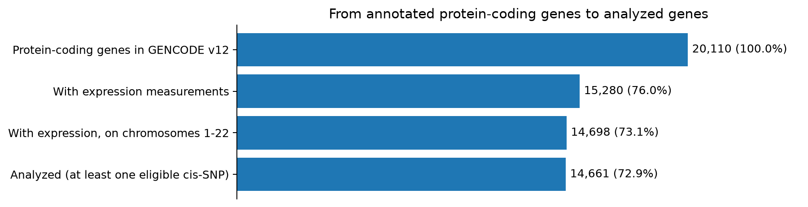
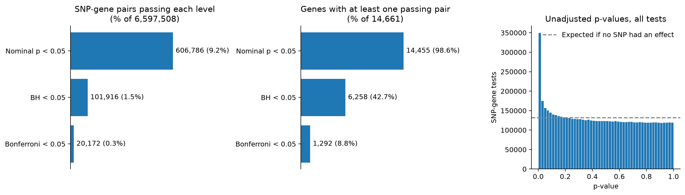
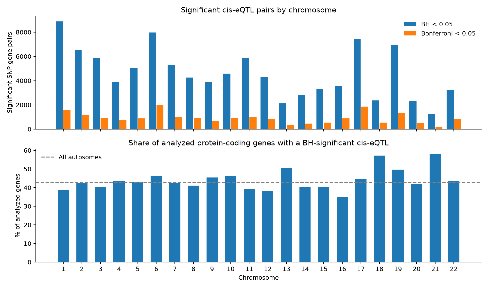
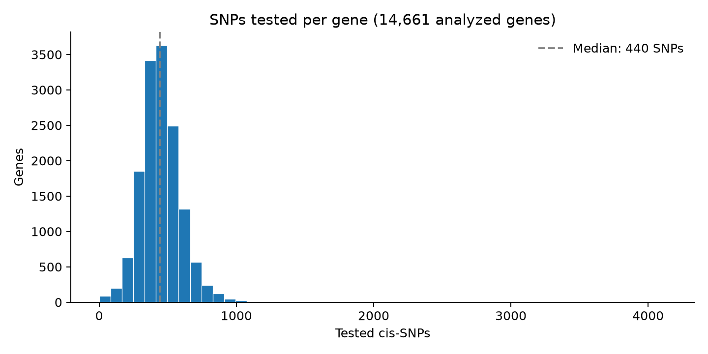
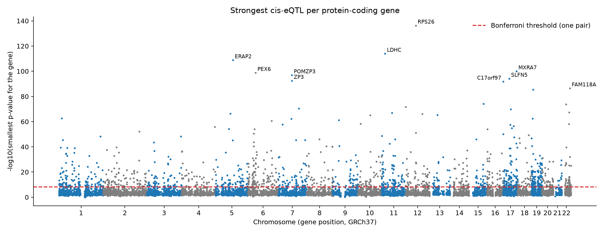
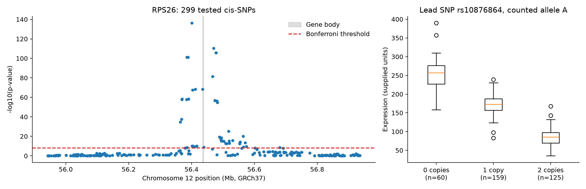
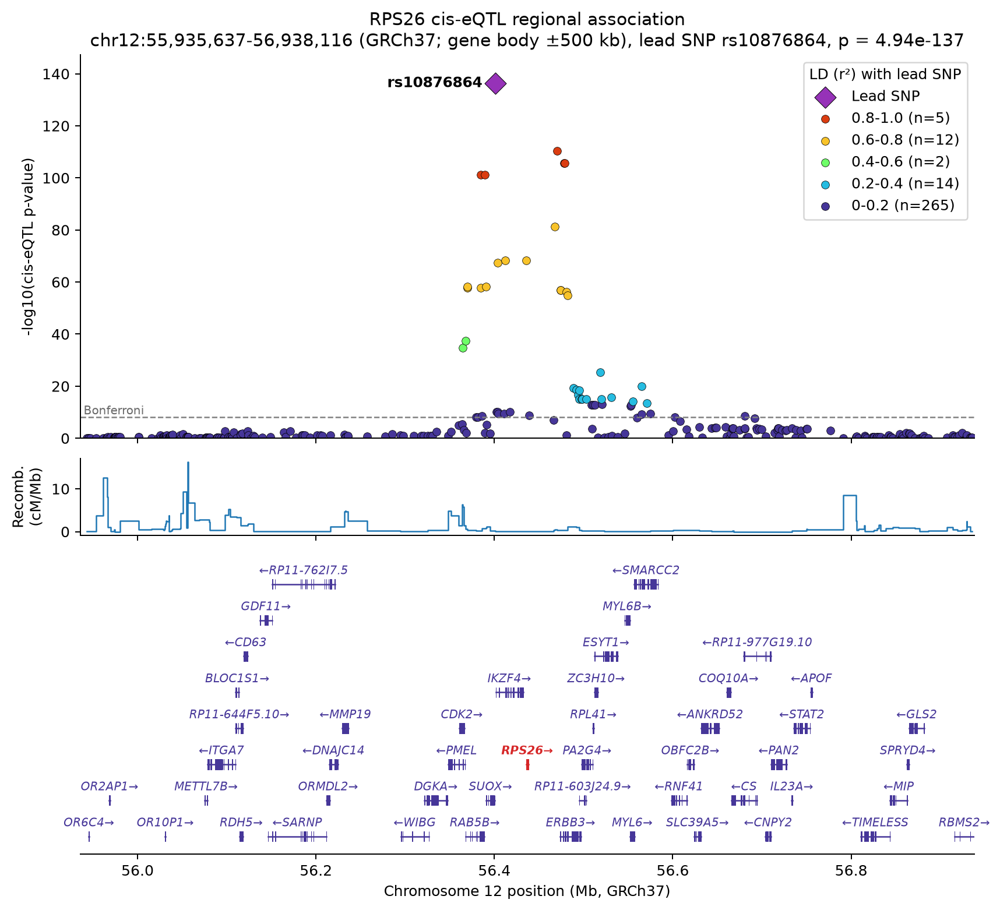

# Quarter 1 Part 1: Methods and Results Reference Notes

Reference notes for writing the Methods and Results sections of the DSC 180A Quarter 1 paper. This is not paper text.
It covers Part 1 only: the genome-wide protein-coding cis-eQTL analysis on chromosomes 1–22.

**How to read the labels**

| Label | Meaning |
|---|---|
| **Verified implementation** | Read directly from the code, or confirmed from its logs and saved outputs |
| **Reported results** | Numbers from saved outputs. All were checked against Table A or the source tables |
| **Interpretation** | Reasoning about the results. Not a measured fact |
| **Unverified** | Could not be confirmed. Do not state as fact |
| **†** | Computed read-only for these notes from the raw inputs and Table A. **Not saved in any repository output**, so it cannot be traced to a file. See [K](#k-items-requiring-confirmation) before citing |

Notebook cells are numbered from 0, in file order, in [notebooks/quarter1_project.ipynb](../notebooks/quarter1_project.ipynb).
No regression was rerun for these notes except a single refit of the RPS26 lead SNP. No analysis file was changed.

## Read This First

Every preliminary number in the request is correct. These findings change how the methods should be described:

1. **The expression data were already adjusted for latent factors.** The regression has no covariates, but the input is
   GEUVADIS's PEER-normalized file, not raw RPKM. Do not write "no adjustment for technical variation."
   See [B.2](#b2-expression-data).
2. **The counted allele is usually the major allele,** not the minor allele. It is the panel's `.bim` A2 allele. A negative
   beta usually means the minor allele is associated with *higher* expression. See [D.3](#d3-genotype-coding).
3. **Week 6 did not study RPS26.** Its LocusZoom analysis was on **FAM118A** on chromosome 22. Both RPS26 figures come from
   the Part 1 notebook. See [G.5](#g5-part-1-figures-versus-the-week-6-analysis).
4. **Figure 07 is not LocusZoom software output.** It is a matplotlib plot in LocusZoom's layout (cell 20, cell 21).
5. **The gene percentages are not gene-level FDR results.** BH and Bonferroni were applied to SNP–gene pairs. A gene is simply
   counted if any of its pairs passes. See [E.3](#e3-what-the-gene-counts-mean).
6. **One sentence in [quarter1_part1_results.md](../quarter1_part1_results.md) should change.** It says strong SNPs overlap SUOX,
   but no Bonferroni-significant SNP lies inside SUOX†. See [K](#k-items-requiring-confirmation).

No figure errors were found, and no figures were changed.

---

## A. Data Sources and Study Population

### A.1 Pipeline location

| Item | Location |
|---|---|
| Analysis notebook | [notebooks/quarter1_project.ipynb](../notebooks/quarter1_project.ipynb) |
| Regression and correction functions | [src/eqtl.py](../src/eqtl.py): `fit_cis`, `map_chromosome`, `add_multiple_testing_columns`, `summarize_genes` |
| PLINK2 discovery and wrapper | [src/utils.py](../src/utils.py): `plink2_path`, `run_plink` |
| Runner | [scripts/run_full_analysis.py](../scripts/run_full_analysis.py) |
| Published tables and figures | [results/part1/](../results/part1/), [results/part1/figures/](../results/part1/figures/) |
| Full local outputs, not in Git | `data/quarter1_results/part1/` |

### A.2 Inputs

| Dataset | File | Source | Status |
|---|---|---|---|
| Genotypes | `data/LDREF/1000G.EUR.{1..22}.{bed,bim,fam}` | FUSION LD reference, [LDREF.tar.bz2](https://data.broadinstitute.org/alkesgroup/FUSION/LDREF.tar.bz2) | Public |
| Expression | `data/GD462.GeneQuantRPKM.50FN.samplename.resk10.txt` | GEUVADIS, [E-GEUV-1](https://www.ebi.ac.uk/biostudies/arrayexpress/studies/E-GEUV-1), supplied through the course | Public |
| Annotation | `data/quarter1_results/part1/gencode.v12.annotation.gtf.gz` | [GENCODE release 12](https://www.gencodegenes.org/human/release_12.html), downloaded in cell 3 | Public |

`data/gene_annot.txt.gz` is **not used**, because cell 2 records that it has GRCh38 coordinates. Part 1 uses no private
genotype data.

### A.3 Genotype panel

**Verified implementation**

- 489 individuals in all 22 `.fam` files. The sample lists are identical across chromosomes†.
- FID equals IID for every person. Sex and phenotype columns are unset (`0`, `-9`)†.
- **1,190,321 SNPs** across chromosomes 1–22†, from 17,040 (chr 21) to 99,735 (chr 2).
- Biallelic ACGT SNPs only. PLINK logs report the `--snps-only just-acgt --min-alleles 2 --max-alleles 2` filters had no effect
  (`chr12.log`). Row counts match between `.bim` and `.traw` on all 22 chromosomes†.
- No duplicate SNP IDs or duplicate positions within a chromosome†. Only 4 strand-ambiguous A/T or C/G SNPs†.

**Unverified**

- **Panel identity.** The [FUSION page](http://gusevlab.org/projects/fusion/) calls this "(1000 Genomes) LD reference data" but does
  not give its 1000 Genomes phase, its sample count, or how it was filtered.
- **HapMap3 restriction.** A [secondary source](https://opain.github.io/MDD-TWAS/MDD_TWAS.html) says the standard FUSION reference is restricted to
  HapMap3 variants. The panel's size fits this, but no primary source was found.
- **Genome assembly.** No LDREF file declares GRCh37. The README states it, and there is indirect support: among genes with a Bonferroni hit,
  the lead SNP's median distance from the gene body under GRCh37 annotation is 2,383 bp†.
- Do not confuse this panel with the published count. [1000 Genomes (2015)](https://pmc.ncbi.nlm.nih.gov/articles/PMC4750478) Table 1 lists 503 EUR samples.
  Its "489" is the South Asian column, a coincidence.

### A.4 Expression dataset

**Verified implementation**

- LCL mRNA sequencing from GEUVADIS, 462 individuals, 23,722 genes or other expressed units (cell 1).
- Every one of the 23,722 row IDs exactly matches a GENCODE v12 gene†. The GEUVADIS
  [README](https://ftp.ebi.ac.uk/biostudies/fire/E-GEUV-/001/E-GEUV-1/Files/E-GEUV-1/analysis_results/GeuvadisRNASeqAnalysisFiles_README.txt) confirms GENCODE v12 identifiers.
- Row types†: 15,280 protein-coding, 4,853 pseudogene, 1,450 antisense, 1,153 lincRNA, 476 processed transcript, and others.
- Columns: `TargetID`, `Gene_Symbol`, `Chr`, `Coord`, then one column per person. `Gene_Symbol` actually repeats the Ensembl ID for all rows†, so
  gene names in the results come from GENCODE.

**File integrity.** The first ~98.5% of the released `.gz` (89.5 of 90.8 MB) decompressed to bytes identical to the local file†. The download timed out
before the end, so the whole file is not confirmed identical.

### A.5 Sample matching

**Verified implementation** (cell 1)

- People are matched by exact IID between the `.fam` file and the expression column headers, keeping `.fam` order.
- Matched IDs are written to `matched.keep`, then used by PLINK `--keep` on each chromosome.
- **344 people** are matched, and **all 344 are used in every test**: `N` is 344 in every Table A row (check "Every test uses all 344 people").
- There are no exclusions beyond non-overlap between the two datasets, and no relatedness or outlier filtering in the code.

| | People |
|---|---:|
| Expression file | 462 |
| Genotype panel | 489 |
| **Matched and analyzed** | **344** |
| In expression file, not panel | 118 |
| In panel, not expression file | 145 |

**Study population†**, from the [E-GEUV-1 sample table](https://ftp.ebi.ac.uk/biostudies/fire/E-GEUV-/001/E-GEUV-1/Files/E-GEUV-1.sdrf.txt):

| Label in the sample table | Expression file | Matched |
|---|---:|---:|
| Finnish | 95 | 92 |
| Tuscan | 93 | 88 |
| Utah | 91 | 84 |
| British | 94 | 80 |
| Yoruba | 89 | 0 |
| **Total** | **462** | **344** |

So all 344 are European-ancestry. The 118 unmatched expression samples are all 89 Yoruba and 29 European samples.
The matched group is 180 female and 164 male†. Sex was not used in the model.

---

## B. Genotype and Expression Preprocessing

### B.1 Genotypes

**Verified implementation** (`map_chromosome` in `src/eqtl.py`)

```text
plink2 --bfile data/LDREF/1000G.EUR.{chrom} --keep matched.keep --snps-only just-acgt
       --min-alleles 2 --max-alleles 2 --export Av --out chromosomes/chr{chrom}
       --threads 2 --memory 1024
```

| Step | Applied? |
|---|---|
| Subset to the 344 matched people | Yes |
| ACGT biallelic SNP filter | Yes, but it removed nothing |
| MAF, minor allele count filter | **No.** Cell 0 states this, and the code has none |
| Hardy–Weinberg filter | **No** |
| Genotype missingness filter | **No,** and nothing was missing |
| LD pruning, clumping, or fine-mapping | **No** |
| Must vary among the 344 people | **Yes,** in `fit_cis` |

**Missing genotypes.** `fit_cis` omits missing values (`nan_policy='omit'`) and requires at least 3 non-missing values. This path never ran: there are
**0 missing genotypes** across all 344 people and all SNPs†. All values are the integers 0, 1, or 2†. No imputation was performed by this project.

**Allele frequency in the 344†**

| Minor allele count | Panel SNPs |
|---|---:|
| 0 (monomorphic) | 45 |
| 1 | 439 |
| 2–4 | 6,821 |
| 5–9 | 18,868 |
| 10 or more | 1,164,148 |

Median MAF is 0.227. The 1st and 5th percentiles are 0.0087 and 0.026.

### B.2 Expression data

**Verified from the GEUVADIS README.** The README's normalization tier for these quantifications is
"Library depth & expressed & PEER": "Library depth scaling as above, removal of units with 0 counts in >50% samples, and removal of technical variation by
PEER normalization." It also records that a `.norm` version with an additional per-gene standard-normal transformation "has been replaced by"
this file.

**Measured directly from the file†**

| Property | Value |
|---|---|
| Rank after centering each gene and scaling it to unit variance | **451** of 462 samples, with a sharp break after the 451st singular value (≈92 to ≈8 × 10⁻¹²) |
| Missing values | 0, in the 344 people and in all 462 |
| Exact zeros | 0 (344 people) |
| Negative values | 285,156 (3.49% of values), in 10,437 genes (344 people) |
| Range | −3,465.2 to 75,846.5 (cell 1) |
| Median of all values | 2.81 (344 people) |
| Per-gene mean across 462 people | Positive for all genes. Minimum 0.0029, median 3.08 |
| `Coord` column | Gene start on + strand and gene end on − strand for all 15,280 protein-coding matches, so it is the strand-aware start site |

**Verified implementation in this project**

- Values are read as supplied and converted to float. **No log, quantile, inverse-normal, or other transformation** is applied (`cell 1`, `fit_cis`).
- `Coord` is used only as a check that it lies within the gene body. It is not used to define the window.

**Interpretation**

- A rank of 451 is what removing exactly 10 latent dimensions plus each gene's mean would give (462 − 1 − 10). This agrees with `k10` in `resk10`. The
  10 dimensions span all 462 samples, so the factors seem to have been fitted with the Yoruba samples included.
- Negative values are consistent with residuals. Positive gene means suggest means were added back.
- "RPKM" in the filename should not be taken as literal units. Call these "PEER-normalized GEUVADIS expression values."

**Unverified**

- The README never spells out `resk10` or `50FN`, nor says that means were added back. The readings above come from the tier description, the filename, and the rank test.
- Whether transcript-length normalization (RPKM) is retained. The filename says RPKM, but the PEER tier's wording mentions only library depth scaling.
  The Supplementary Methods of Lappalainen et al. and `GeuvadisRNASeqAnalysisFiles.xlsx` (not retrieved) should settle this.

---

## C. Protein-Coding Gene Annotation and Filtering

### C.1 Annotation

**Verified implementation** (cell 3)

- GENCODE v12. The GTF header reads: `evidence-based annotation of the human genome (GRCh37), version 12 (Ensembl 67)`.
- Only `gene` feature rows are used. There are 53,934 genes of all types.
- A gene is protein-coding when `gene_type` is `protein_coding`. This gives 20,110 genes.
- Gene IDs are matched as **exact versioned Ensembl IDs**, such as `ENSG00000197728.5`, using `genes.index.isin(expression.index)`.
- Version mismatch does not explain lost genes: **none** of the 4,830 genes without expression has a row under another version of its ID†.

### C.2 Filtering flow

All four counts are confirmed by cell 3 and cell 7 output, `excluded_genes.tsv`, and Table B (5,449 + 14,661 = 20,110).

| Stage | Genes remaining | % of 20,110 | Removed | Reason recorded by the code |
|---|---:|---:|---:|---|
| GENCODE v12 protein-coding | 20,110 | 100.0% | – | – |
| Has an expression row | 15,280 | 76.0% | 4,830 | `No expression measurement` |
| On chromosomes 1–22 | 14,698 | 73.1% | 582 | `Not on an autosome (X, Y, or mitochondrial)` |
| At least one tested cis-SNP | **14,661** | **72.9%** | 37 | `No eligible cis-SNPs` |

**The three exclusion types are distinct:**

- **No expression, 4,830 genes.** No row in the supplied file. This group is 4,491 autosomal and 339 non-autosomal genes†.
- **Outside the autosomal analysis, 582 genes.** They have expression but are on X (538), Y (31), or mitochondrial DNA (13)†. Because of the filter order, this is **not** the
  total non-autosomal count: GENCODE has 921 non-autosomal protein-coding genes (836 X, 72 Y, 13 M)†.
- **No eligible cis-SNPs, 37 genes.** All 37 have **zero panel SNPs** in their window†. None was lost to monomorphic SNPs†. By chromosome:
  12 (20), 9 (8), 6 (4), 1 (2), 5 (1), 14 (1), 21 (1). On chromosome 12, the panel has no SNPs between 6,956,462 and 10,000,986 (cell 16). The chromosome 6 group is HLA-E, GNL1, PRR3, and ABCF1.

The code's other checks removed **no** genes (cell 3): chromosome disagreement, `Coord` outside the gene body, fewer than 3 expression observations, constant expression.

**Interpretation.** The README describes a filter removing units with 0 counts in more than 50% of samples, so that is the likely cause for many of the
4,830 genes. **This is not confirmed per gene,** because the supplied file has no record of removed genes. The code only records that they are absent.

---

## D. Genome-Wide cis-eQTL Association Analysis

### D.1 Answers to the method questions

| # | Question | Answer | Evidence |
|---|---|---|---|
| 1 | Gene coordinates | GENCODE v12 `gene` rows, columns 4 and 5 | cell 3 |
| 2 | cis-region | $[\max(1,\ \text{start}-500{,}000),\ \text{end}+500{,}000]$, inclusive | cell 3 |
| 3 | Gene body plus 500 kb each side? | **Yes.** Not TSS-based | cell 3, window check in cell 13 |
| 4 | Finding SNPs | Same chromosome, and `POS` within the window | `map_chromosome` |
| 5 | Genotype coding | 0, 1, or 2 copies of `COUNTED` | `--export Av` |
| 6 | Alignment | By person ID, not by file order | `fit_cis` |
| 7 | Regression | Ordinary least squares, one SNP at a time | `scipy.stats.linregress` |
| 8 | Intercept | **Yes** | `linregress` default model |
| 9 | Beta | Change in supplied expression units per counted-allele copy | D.2 |
| 10 | SE and p | OLS slope SE; two-sided t-test | D.2 |
| 11 | Covariates | **None in the model.** Input was PEER-normalized beforehand | B.2 |
| 12 | Separate per pair? | **Yes,** each pair has its own regression | `fit_cis` |
| 13 | Missing or monomorphic | Missing omitted (none occurred); monomorphic skipped | `fit_cis` |
| 14 | Scaling | One chromosome at a time; D.5 | `map_chromosome` |

### D.2 Statistical model

For gene $j$, SNP $k$ in its cis-window, and person $i$ in the $n=344$ matched people:

$$
y_{ij} = \beta_{0,jk} + \beta_{1,jk}\, g_{ik} + \varepsilon_{ijk}, \qquad g_{ik} \in \{0,1,2\}
$$

$$
\hat\beta_{1,jk} = \frac{\sum_i (g_{ik}-\bar g_k)(y_{ij}-\bar y_j)}{\sum_i (g_{ik}-\bar g_k)^2},
\qquad t_{jk} = \frac{\hat\beta_{1,jk}}{\widehat{\mathrm{SE}}(\hat\beta_{1,jk})},
\qquad p_{jk} = 2\,P\!\left(T_{342} \ge |t_{jk}|\right)
$$

Here $y_{ij}$ is the supplied, PEER-normalized expression value and $g_{ik}$ is the count of the `COUNTED` allele.

- The p-values match a t distribution with 342 degrees of freedom: maximum relative difference 1.9 × 10⁻¹² across 200,000 randomly sampled pairs†.
- The model is additive. Dominance effects and interactions were not tested.
- Beta is in each gene's own expression units. **Betas are not comparable across genes,** so rank genes by p-value.
- Degrees of freedom do not account for the 10 factors removed before this analysis, and genotypes were not residualized against those factors. The effect on the p-values was not measured.

### D.3 Genotype coding

**Verified†.** `COUNTED` equals the `.bim` column 6 allele (A2) for every SNP on all chromosomes. It is the minor allele in the 344 people for only about **1%** of SNPs.

**Consequence.** The sign of beta is relative to an allele that is usually the major allele. Report the allele with any effect direction, and do not call beta a minor-allele effect. The sign must not be compared between SNPs without checking their counted alleles.

### D.4 SNP eligibility

**Verified implementation.** `fit_cis` tests a SNP only when all of these hold: both alleles are single ACGT bases and differ, at least 3 non-missing genotypes, and nonzero genotype variance.

**Accounting†**

| Quantity | Count |
|---|---:|
| SNP–gene pairs in windows of the 14,698 eligible genes | 6,597,807 |
| Pairs dropped because the SNP is monomorphic in the 344 people | 299 |
| **Pairs tested (Table A rows)** | **6,597,508** |

Only 45 SNPs are monomorphic. Those 299 pairs are unrelated to the RPS26 count of 299 tested SNPs. Table A covers 1,001,779 unique SNPs (84.2% of the panel)†. A median SNP is tested against 5 genes†.

### D.5 Computational scaling

**Verified implementation** (`map_chromosome`)

- **Sequential by chromosome.** There is no parallelism across chromosomes.
- **Chunked reading:** each `.traw` is read in chunks of 2,000 SNPs, so the whole chromosome is not in memory.
- **Overlap pre-filter:** only genes whose window overlaps the chunk's position range are processed.
- **Vectorized regression:** `linregress(..., axis=1)` fits all of a gene's SNPs in a chunk at once.
- **Resumable writes:** each chromosome writes to a temporary file and uses `os.replace` when finished. Finished files are reused unless `REBUILD = True`.
- PLINK2 limits: 2 threads, 1,024 MB.

### D.6 Outputs and verification

| Table | Rows | Contents | Location |
|---|---:|---|---|
| A | 6,597,508 | One SNP–gene pair per row | Local only: `data/quarter1_results/part1/table_A_genome_wide_cis_eqtl.tsv.gz` (282 MB) |
| B | 14,661 | One gene per row | `results/part1/table_B_gene_summary.tsv` |
| C | 22 | One chromosome per row | `results/part1/table_C_chromosome_summary.tsv` |

**23 checks passed** (`results/part1/verification_checks.tsv`, cell 13), and the notebook stops if one fails. They cover:

- **Scope:** 22 autosomes, protein-coding only, every gene analyzed or given a reason.
- **Windows:** SNPs on the gene's chromosome and inside the window, with no duplicate pairs.
- **Samples:** all 344 used, and present in all files.
- **Statistics:** valid p, beta, SE; BH and Bonferroni counts recomputed directly.
- **Bookkeeping:** Tables A, B, and C agree.
- **Reproduction:** chromosome 1 reproduces all 668,215 Week 4 protein-coding pairs (largest beta difference 0.0, p difference 2.6 × 10⁻²³). PARK7 reproduces Week 3 (rs11805932, p = 9.96 × 10⁻⁴). One pair (FAM118A, rs104664) was refit from raw files with `numpy.polyfit`.

Four checks depend on local Week 2–4 files, so a fresh clone runs 19, according to the results file.

**Independent recheck for these notes†.** Recomputing Table B's counts from Table A matched every gene. The headline counts, BH cutoff, Bonferroni cutoff, and chromosome totals all matched. Published `results/part1/*.tsv` files are byte-identical to the local working copies.

---

## E. Multiple-Testing Correction

### E.1 Which methods

| Criterion | Used? | Definition |
|---|---|---|
| Nominal | Yes, descriptive only | $p < 0.05$, unadjusted |
| Benjamini–Hochberg | **Yes** | `scipy.stats.false_discovery_control(method='bh')`, adjusted $p < 0.05$ |
| Bonferroni | **Yes** | $\min(p \cdot m,\ 1) < 0.05$ |

Permutation testing, q-values, and gene-level correction were **not used**.

### E.2 Testing family

**One family: all SNP–gene pairs genome-wide.** $m = 6{,}597{,}508$.

| Possible family | Used? |
|---|---|
| All SNP–gene pairs genome-wide | **Yes** |
| Each chromosome separately | **No** |
| Each gene separately | **No** |

Evidence: cell 7 concatenates all 22 chromosome files *before* calling `add_multiple_testing_columns`, which uses `len(associations)` as the family size.

| Criterion | Effective p-value cutoff | Largest passing p |
|---|---|---|
| BH | $p_{(k)} \le \frac{k}{m}(0.05)$ with $k=101{,}916$, giving about $7.72 \times 10^{-4}$ | 7.7238 × 10⁻⁴ |
| Bonferroni | $0.05/m = 7.5786 \times 10^{-9}$ | 7.5577 × 10⁻⁹ |

The two criteria answer different questions: BH controls the expected false discovery proportion among hits, and Bonferroni limits the chance of any false positive in the family.

### E.3 What the gene counts mean

A gene counts as significant if at least one of its pairs passes the pair-level genome-wide threshold (cell 6). This is **not** a separate gene-level FDR, and "6,258 genes at 5% FDR" should **not** be written.

**Suggested precise wording:** "6,258 genes had at least one SNP–gene pair significant at BH-adjusted p < 0.05 across all pairs."

### E.4 Dependence

Tests are correlated through LD and because one SNP is tested for many genes. Neither correction models this explicitly, and no effective number of tests was estimated.

---

## F. Main Numerical Results

### F.1 Overall results

All nine preliminary values are **confirmed**.

| Level | SNP–gene pairs | % of 6,597,508 | Genes | % of 14,661 |
|---|---:|---:|---:|---:|
| Tested | 6,597,508 | 100% | 14,661 | 100% |
| Nominal $p<0.05$ | 606,786 | 9.20% | 14,455 | 98.60% |
| BH $<0.05$ | 101,916 | 1.54% | 6,258 | 42.68% |
| Bonferroni $<0.05$ | 20,172 | 0.31% | 1,292 | 8.81% |

**SNPs tested per gene:** median 440, mean 450.0, SD 153.3, IQR 358–529, minimum 1, maximum 4,133 (cell 16). Fewer than 10 SNPs: 31 genes†. More than 1,000: 53 genes†.

**Other descriptive counts†**

| Measure | Value |
|---|---:|
| Expected nominal pairs if all nulls were true ($0.05m$) | 329,875 |
| Unique SNPs in BH pairs / Bonferroni pairs | 80,939 / 18,136 |
| Median significant SNPs per significant gene: BH / Bonferroni | 6 / 9 (cell 23) |
| Genes with exactly one significant SNP: BH / Bonferroni | 1,313 / 184 |
| Genes with no nominal hit | 206 |

### F.2 By chromosome

From `table_C_chromosome_summary.tsv`. Rate columns are calculated from it. The Bonferroni gene column† comes from Table B.

| Chr | Genes | Tests | BH pairs | BH % of tests | Bonf. pairs | Bonf. % of tests | Genes with BH hit | % genes | Genes with Bonf. hit† |
|---:|---:|---:|---:|---:|---:|---:|---:|---:|---:|
| 1 | 1,566 | 668,215 | 8,881 | 1.33 | 1,569 | 0.23 | 606 | 38.7 | 120 |
| 2 | 966 | 422,393 | 6,530 | 1.55 | 1,165 | 0.28 | 408 | 42.2 | 78 |
| 3 | 841 | 382,698 | 5,890 | 1.54 | 924 | 0.24 | 339 | 40.3 | 68 |
| 4 | 521 | 240,675 | 3,910 | 1.62 | 751 | 0.31 | 227 | 43.6 | 41 |
| 5 | 670 | 314,599 | 5,078 | 1.61 | 889 | 0.28 | 288 | 43.0 | 68 |
| 6 | 799 | 376,952 | 7,979 | 2.12 | 1,969 | 0.52 | 368 | 46.1 | 100 |
| 7 | 692 | 295,955 | 5,289 | 1.79 | 1,024 | 0.35 | 295 | 42.6 | 65 |
| 8 | 535 | 248,689 | 4,256 | 1.71 | 900 | 0.36 | 220 | 41.1 | 38 |
| 9 | 600 | 283,999 | 3,898 | 1.37 | 706 | 0.25 | 273 | 45.5 | 52 |
| 10 | 599 | 295,756 | 4,572 | 1.55 | 917 | 0.31 | 278 | 46.4 | 49 |
| 11 | 868 | 393,633 | 5,849 | 1.49 | 1,036 | 0.26 | 342 | 39.4 | 79 |
| 12 | 802 | 360,017 | 4,298 | 1.19 | 822 | 0.23 | 305 | 38.0 | 56 |
| 13 | 247 | 134,074 | 2,130 | 1.59 | 361 | 0.27 | 125 | 50.6 | 27 |
| 14 | 512 | 250,499 | 2,825 | 1.13 | 460 | 0.18 | 207 | 40.4 | 42 |
| 15 | 505 | 213,731 | 3,350 | 1.57 | 534 | 0.25 | 203 | 40.2 | 29 |
| 16 | 721 | 285,673 | 3,578 | 1.25 | 886 | 0.31 | 251 | 34.8 | 44 |
| 17 | 944 | 377,284 | 7,460 | 1.98 | 1,867 | 0.49 | 420 | 44.5 | 101 |
| 18 | 208 | 111,517 | 2,373 | 2.13 | 535 | 0.48 | 119 | 57.2 | 30 |
| 19 | 1,142 | 478,553 | 6,966 | 1.46 | 1,348 | 0.28 | 567 | 49.6 | 120 |
| 20 | 394 | 197,902 | 2,308 | 1.17 | 493 | 0.25 | 165 | 41.9 | 33 |
| 21 | 147 | 87,348 | 1,250 | 1.43 | 162 | 0.19 | 85 | 57.8 | 10 |
| 22 | 382 | 177,346 | 3,246 | 1.83 | 854 | 0.48 | 167 | 43.7 | 42 |
| **All** | **14,661** | **6,597,508** | **101,916** | **1.54** | **20,172** | **0.31** | **6,258** | **42.7** | **1,292** |

**Largest counts**

| Measure | First | Second | Third |
|---|---|---|---|
| BH pairs | chr 1 (8,881) | chr 6 (7,979) | chr 17 (7,460) |
| Bonferroni pairs | chr 6 (1,969) | chr 17 (1,867) | chr 1 (1,569) |
| Genes with a BH hit | chr 1 (606) | chr 19 (567) | chr 17 (420) |
| Highest BH rate per test | chr 18 (2.13%) | chr 6 (2.12%) | chr 17 (1.98%) |
| Highest % genes with BH hit | chr 21 (57.8%) | chr 18 (57.2%) | chr 13 (50.6%) |

**Size effect†.** Across chromosomes, tests correlate with BH pairs (Pearson r = 0.91). Analyzed genes correlate with genes having a BH hit (r = 0.98). So raw counts largely track chromosome size and gene content. This uses 22 points and no test was run.

**Interpretation and limit.** Rates vary, from 1.13% to 2.13% of tests and from 34.8% to 57.8% of genes, but **no statistical test of chromosome differences was run**. The highest gene shares are on chromosomes with few genes (147 and 208). Do not claim a chromosome is enriched.

### F.3 Strongest genes

From cell 17 and `top_gene_robustness.tsv`. MAC is the minor allele count in the 344 people. "Max z" is the largest expression z-score for that gene.

| Rank | Gene | Chr | Lead SNP | Counted | Beta | SE | Regression p | Bonferroni p | MAC | Spearman p | Max z |
|---:|---|---:|---|---:|---:|---:|---:|---:|---:|---:|---:|
| 1 | RPS26 | 12 | rs10876864 | A | −86.07 | 2.05 | 4.94e−137 | 3.26e−130 | 279 | 2.43e−128 | 3.53 |
| 2 | LDHC | 11 | rs4757650 | C | −1.26 | 0.036 | 1.11e−114 | 7.34e−108 | 75 | 2.04e−48 | 5.52 |
| 3 | ERAP2 | 5 | rs27290 | A | −15.45 | 0.46 | 1.64e−109 | 1.08e−102 | 289 | 8.17e−99 | 2.68 |
| 4 | MXRA7 | 17 | rs9303003 | C | −2.86 | 0.093 | 1.07e−100 | 7.06e−94 | 65 | 1.00e−44 | 4.49 |
| 5 | PEX6 | 6 | rs10948059 | C | −2.98 | 0.098 | 1.68e−99 | 1.11e−92 | 338 | 3.96e−102 | 2.99 |
| 6 | POMZP3 | 7 | rs17718122 | A | −4.97 | 0.17 | 1.37e−97 | 9.05e−91 | 195 | 2.10e−101 | 4.10 |
| 7 | SLFN5 | 17 | rs883416 | C | −6.53 | 0.22 | 7.41e−95 | 4.89e−88 | 343 | 8.33e−91 | 2.74 |
| 8 | ZP3 | 7 | rs17718122 | A | −4.25 | 0.15 | 3.24e−93 | 2.14e−86 | 195 | 8.10e−92 | 4.06 |
| 9 | C17orf97 | 17 | rs11150882 | G | −2.65 | 0.093 | 1.60e−92 | 1.06e−85 | 163 | 1.17e−97 | 4.45 |
| 10 | FAM118A | 22 | rs104664 | A | −13.17 | 0.49 | 3.26e−87 | 2.15e−80 | 89 | 4.66e−51 | 4.54 |
| 11 | ZNF266 | 19 | rs7246415 | G | 2.35 | 0.088 | 3.87e−86 | 2.56e−79 | 319 | 4.46e−89 | 3.25 |
| 12 | FAM154B | 15 | rs12439679 | G | −4.11 | 0.17 | 7.98e−75 | 5.26e−68 | 15 | 8.44e−11 | 8.85 |
| 13 | GSTT1 | 22 | rs5760176 | A | 7.18 | 0.30 | 2.03e−74 | 1.34e−67 | 311 | 5.46e−74 | 2.97 |
| 14 | B4GALNT3 | 12 | rs7314691 | G | −0.46 | 0.020 | 2.15e−72 | 1.42e−65 | 191 | 9.93e−76 | 4.46 |
| 15 | CAV2 | 7 | rs2191498 | C | −3.91 | 0.17 | 3.76e−71 | 2.48e−64 | 66 | 1.62e−42 | 7.97 |

All 15 still pass the Bonferroni cutoff by Spearman p. Spearman was run **only for these 15 genes**, not genome-wide.

### F.4 Noteworthy findings

These are descriptive. **None establishes a biological mechanism.**

- **Sensitivity to outliers.** FAM154B has MAC 15 and one person at z = 8.85, and its p weakens from 8.0 × 10⁻⁷⁵ to 8.4 × 10⁻¹¹ with ranks. LDHC, MXRA7, FAM118A, and CAV2 also weaken by many orders of magnitude.
- **Rare-allele tests** (`minor_allele_count_summary.tsv`, cell 23). SNPs with MAC below 10 are 157,225 tests (2.38%) and 127 Bonferroni pairs (0.63%). 59 of the 1,292 Bonferroni genes and 254 of the 6,258 BH genes have hits only from these SNPs.

| MAC | Tests | Nominal rate | BH pairs | Bonferroni pairs |
|---|---:|---:|---:|---:|
| 1 | 2,462 | 4.39% | 15 | 5 |
| 2–4 | 40,051 | 5.66% | 346 | 63 |
| 5–9 | 114,712 | 5.86% | 688 | 59 |
| ≥10 | 6,440,283 | 9.28% | 100,867 | 20,045 |

- **More tested SNPs, more significant genes†.** Quartiles of `SNPs_Tested` show a gradient, and this could reflect more chances for a hit, gene context, or both:

| Quartile (median SNPs) | Genes | Any BH hit | Any Bonferroni hit |
|---|---:|---:|---:|
| Q1 (298) | 3,693 | 30.7% | 7.3% |
| Q2 (400) | 3,669 | 42.0% | 8.5% |
| Q3 (481) | 3,653 | 45.6% | 9.3% |
| Q4 (607) | 3,646 | 52.5% | 10.2% |

- **Lead SNP location†.** Among the 1,292 Bonferroni genes, 42.4% have the lead SNP inside the annotated gene body. Median distance to the body is 2,383 bp. These are gene-body distances, not TSS distances.
- **Shared leads†.** 66 Bonferroni genes share a lead SNP with another gene, such as POMZP3 and ZP3 (rs17718122). Pairs are therefore not independent signals.
- **Most significant SNPs per gene†.** By Bonferroni: AC110373.1 (135), FTSJ3 (118), NDUFAF1 (115). By BH: AF131215.2 (352), BLK (340), FAM167A (289), all three on chromosome 8. Whether the latter three share one signal was not tested.
- **Chromosome 6†.** SNPs at 25–34 Mb contribute 77,567 tests, 1,981 BH pairs, and 476 Bonferroni pairs. Excluding them, chromosome 6 still has rates of 2.00% and 0.50%, so this one region does not account for its high rate. These boundaries were picked only for this check, so do not present it as a formal MHC analysis.
- **Very long gene bodies.** TMPRSS3 spans 5.38 Mb with 4,133 SNPs, and MX2 spans 3.01 Mb with 2,426 SNPs (cell 16). Neither has a Bonferroni hit. These spans come from GENCODE v12 and were kept. Why they are so long was not investigated.
- **p-value distribution.** Figure 02 shows a spike near zero. The first 0.02 bin holds 350,354 tests, against 131,950 expected under a uniform distribution†. Bins above 0.5 average 120,995, about 8.3% below the uniform line†, which is expected when some tests carry signal. No formal $\pi_0$ estimate was part of the analysis.

### F.5 Association versus causation

These are statistical associations in an observational sample. They do not show that a variant causes the expression change. A significant SNP can tag an untested causal variant through LD. No experimental validation, fine-mapping, conditional analysis, or colocalization was done. The count of significant pairs is **not** a count of independent signals.

---

## G. Representative Gene Locus: RPS26

### G.1 Gene and window

| Item | Value | Evidence |
|---|---|---|
| Symbol, Ensembl ID | RPS26, `ENSG00000197728.5` | Table A |
| Type | `protein_coding` | GENCODE v12 |
| Location, GRCh37 | chr12:56,435,637–56,438,116, + strand | Table A†; figure 07 gene track |
| cis-window | chr12:**55,935,637–56,938,116** | Figure 07 title |
| Outermost tested SNPs | 55,943,026 and 56,935,652 | † |
| SNPs tested | **299** of 299 panel SNPs in the window | Table B† |
| Hits: nominal, BH, Bonferroni | 115, 81, **51** | Table B |

### G.2 Lead SNP

| Item | Value |
|---|---|
| SNP | **rs10876864**, chr12:56,401,085 |
| Alleles | Counted **A**; other allele **G** (`.traw`, `.bim`) |
| A frequency in the 344 | 409/688 = **0.594**, so A is the **major** allele† |
| Minor allele count | 279 (G, MAF 0.406) |
| Beta | **−86.07** supplied expression units per copy of A |
| SE | **2.05** |
| t, df | −42.0, 342† |
| p | **4.94 × 10⁻¹³⁷**, the smallest in Table A |
| BH and Bonferroni p | Both **3.26 × 10⁻¹³⁰** (they coincide at rank 1) |
| Model $R^2$ | **0.838**† |
| Spearman | ρ = −0.904†, p = 2.43 × 10⁻¹²⁸ |
| Intercept | 257.3† |
| Single refit | Reproduced Table A's beta, SE, and p exactly† |

The SNP is 34,552 bp before the gene start (cell 19). With RPS26 on the + strand, that is upstream. It lies between SUOX (ends 56,400,425) and IKZF4 (starts 56,401,443), so it is inside no GENCODE protein-coding gene body†. Non-coding annotation was not checked.

### G.3 Expression by genotype†

| Copies of A | n | Mean | SD | Median | Q1–Q3 | Min–Max |
|---:|---:|---:|---:|---:|---:|---:|
| 0 | 60 | 256.2 | 39.6 | 257.2 | 227.0–276.5 | 158.5–389.9 |
| 1 | 159 | 172.1 | 24.3 | 172.7 | 157.2–187.8 | 83.1–238.8 |
| 2 | 125 | 84.6 | 22.4 | 85.3 | 69.8–97.9 | 35.3–167.7 |

Medians, group sizes, and their display are confirmed by cell 19 and figure 06. Units are the supplied PEER-normalized values, so these are not raw expression levels. The genotype counts are near the Hardy–Weinberg expected 56.6, 165.9, and 121.6†, though no test was run.

### G.4 LD and the regional signal

**How r² was calculated** (`locus_zoom`, cell 21). `np.corrcoef` on dosages across the same 344 people, squared. This is the **squared Pearson correlation of unphased genotype dosages** with the lead SNP. It is not computed from phased haplotypes or an external LD panel.

| r² with lead, lead included | All tested SNPs | Bonferroni-significant |
|---|---:|---:|
| > 0.8 | 6 | 6 |
| > 0.5 | 18 | 18 |
| > 0.2 | 34 | 34 |

Figure 07's legend bins exclude the lead: 0.8–1.0 (5), 0.6–0.8 (12), 0.4–0.6 (2), 0.2–0.4 (14), 0–0.2 (265), plus the lead, for 299 in total.

**Strongest SNPs†**

| SNP | Position | Counted | Beta | p | r² with lead |
|---|---:|---|---:|---:|---:|
| rs10876864 | 56,401,085 | A | −86.07 | 4.94e−137 | 1.000 |
| rs11171739 | 56,470,625 | T | −82.33 | 3.63e−111 | 0.938 |
| rs10876870 | 56,478,002 | C | −81.24 | 1.97e−106 | 0.910 |
| rs7971751 | 56,478,658 | C | −81.24 | 1.97e−106 | 0.910 |
| rs705700 | 56,389,293 | T | −82.30 | 5.54e−102 | 0.889 |
| rs705699 | 56,384,804 | G | −82.87 | 7.45e−102 | 0.873 |

**Other details†**

- rs10876870 and rs7971751 have identical statistics, so these data cannot separate them.
- All 33 non-lead SNPs with r² > 0.2 pass Bonferroni (largest p = 3.85 × 10⁻¹⁴).
- 17 Bonferroni SNPs have r² ≤ 0.2 (p from 9.60 × 10⁻¹⁴ to 7.42 × 10⁻⁹), at positions 56,386,076–56,680,745.
- Bonferroni SNPs span 56,364,321–56,680,745.
- The local recombination rate reaches 6.40 cM/Mb at 56,364,321, which matches that left edge. It is not the window's maximum: 16.26 cM/Mb occurs at 56,056,859.
- Bonferroni SNPs inside protein-coding gene bodies: ERBB3 (11), IKZF4 (7), RAB5B (6), PA2G4 (3), CDK2 (1), PMEL (1), RPS26 (0), SUOX (0).
- rs10876864 is not Bonferroni-significant for any other tested gene. The next-smallest p is BLOC1S1 at 2.2 × 10⁻³.

**Interpretation limits**

- **The lead SNP must not be called causal.** It is only the smallest p-value among tested SNPs. Five others have r² > 0.8 with it, and the true causal variant may not be in the panel.
- **The 17 low-LD hits are unresolved.** They could indicate a second signal, or simply carry through weak LD from a very strong one. No conditional analysis was run.
- **Overlap does not implicate those genes.** The association is measured with RPS26 expression. Physical position says nothing about mechanism.
- Why RPS26 ranks first was not investigated.

### G.5 Part 1 figures versus the Week 6 analysis

| | Figure 06 | Figure 07 | Week 6 LocusZoom |
|---|---|---|---|
| Gene | RPS26 | RPS26 | **FAM118A** |
| Chromosome | 12 | 12 | 22 |
| Notebook | Part 1, cell 19 | Part 1, cell 21 | Weekly tasks |
| Software | matplotlib | matplotlib, LocusZoom layout | LocusZoom.js (`src/locuszoom.py`) |
| LD source | None | `np.corrcoef`, 344 people | PLINK2 unphased r², 344 people |
| Recombination track | No | Yes, from `.bim` cM | No |
| Bonferroni family | Genome-wide protein-coding | Genome-wide protein-coding | Chromosome 22, all gene types, 280,657 tests ($1.78\times10^{-7}$) |
| Saved at | `results/part1/figures/` | `results/part1/figures/` | `data/week6_results/FAM118A_locuszoom.png` (local) |

**Both RPS26 figures belong to Part 1.** Week 6 output is not needed here. Only method continuity connects them: same regression, same people. FAM118A's rs104664 p = 3.26 × 10⁻⁸⁷ is the same in both.

---

## H. Figures and Recommended Placement

All are in `results/part1/figures/`, generated by the Part 1 notebook. None was changed. All were visually inspected against the code and the tables. **No errors were found.**

### Recommended placement

| Figure | Placement | Reason |
|---|---|---|
| 01 Gene filtering | **Main, Methods** (or as a table) | Explains 14,661 versus ~20,000 |
| 02 Multiple testing | **Main, Results** | The central summary |
| 03 By chromosome | **Main, Results** | Required by the project; shows distribution |
| 04 SNPs per gene | Supplementary | Context, not a finding |
| 05 Manhattan | **Main, Results** | Genome-wide overview |
| 06 RPS26 genotype | **Main, Results** (with 07) | Effect at the person level |
| 07 RPS26 regional | **Main, Results** | Shows LD versus causality |

**If space is limited,** prioritize 02, 05, and 07, then put the 01 numbers in a table.

### 01. Gene filtering

`results/part1/figures/01_genes_kept_at_each_filtering_step.png`



- **Plots:** horizontal bars of gene counts at 4 stages, labeled with count and % of 20,110. **No numeric x-axis.**
- **Calculation:** cell 8, from the filtering flags and Table B.
- **Question:** how many annotated protein-coding genes could be analyzed?
- **Limits:** shows only net loss, not why. Pair it with the reasons in [C.2](#c2-filtering-flow). The second-to-third step drop is only the non-autosomal genes *with* expression.

### 02. Multiple testing

`results/part1/figures/02_multiple_testing_results.png`



- **Plots:** left, pairs per level. Middle, genes per level. Right, a 50-bin histogram of unadjusted p-values, with counts per bin on the y-axis and a dashed line at $m/50 = 131{,}950$.
- **Calculation:** cell 9 from `correction_summary.tsv` and Table A.
- **Question:** how much signal survives correction, and is the p-value distribution sensible?
- **Limits:** the panels have different denominators. Pair counts are inflated by LD. The dashed uniform line assumes independent-looking nulls, while real tests are correlated. The gene panel is not gene-level FDR.

### 03. By chromosome

`results/part1/figures/03_significant_cis_eqtls_by_chromosome.png`



- **Plots:** top, BH and Bonferroni pair counts per chromosome. Bottom, % of analyzed genes with a BH hit, with a dashed line at 42.7%. X-axis is chromosomes 1–22.
- **Calculation:** cell 15 from Table C.
- **Question:** how are associations distributed across autosomes?
- **Limits:** counts follow chromosome size. Small chromosomes have noisier percentages. Differences were not tested. The bottom panel uses BH only.

### 04. SNPs tested per gene

`results/part1/figures/04_snps_tested_per_gene.png`



- **Plots:** 50-bin histogram. X-axis is tested cis-SNPs per gene, y-axis is number of genes, dashed line at median 440.
- **Calculation:** cell 16, `SNPs_Tested` in Table B.
- **Question:** how large is the test burden per gene?
- **Limits:** depends on the panel and on gene-body length. The right tail to 4,133 is nearly invisible. Only the 14,661 analyzed genes are shown, so the 37 zero-SNP genes are absent.

### 05. Strongest cis-eQTL per gene

`results/part1/figures/05_manhattan_strongest_cis_eqtl_per_gene.png`



- **Plots:** one point per gene. X-axis is **gene midpoint** across chromosomes, not SNP position. Y-axis is $-\log_{10}$ of the gene's smallest p. Dashed red line at the Bonferroni threshold (−log₁₀ ≈ 8.12). The 10 strongest genes are labeled.
- **Calculation:** cell 17 from Table B. Chromosome offsets use the largest gene midpoint on each chromosome, so chromosome widths are approximate.
- **Question:** which genes show the strongest cis associations, and where?
- **Limits:** **not a conventional SNP-level GWAS Manhattan plot,** so the caption should say so. Minimum p is not adjusted for the SNP count per gene. It does not show effect size. Outlier-sensitive genes (see F.3) still appear high.

### 06. RPS26 association and genotype distribution

`results/part1/figures/06_RPS26_association_and_expression_by_genotype.png`



- **Plots:** left, $-\log_{10}(p)$ versus chr12 position (Mb, GRCh37) for 299 SNPs, with gene body shaded and the Bonferroni line. Right, boxplots of supplied expression units by copies of A: 0 (n=60), 1 (n=159), 2 (n=125).
- **Calculation:** cell 19, from Table A, `chr12.traw`, and the expression file. Boxes are matplotlib defaults, with whiskers at 1.5 × IQR.
- **Question:** does expression change with genotype, and where is the signal?
- **Limits:** the left panel repeats figure 07 without LD. **"Supplied units" must be explained as PEER-normalized.** The trend does not establish causality.

### 07. RPS26 regional plot colored by LD

`results/part1/figures/07_RPS26_locuszoom.png`



- **Plots:** three tracks on chr12 position (Mb). Top: $-\log_{10}(p)$ for each SNP, colored by r² with the lead, with the lead as a purple diamond and a Bonferroni line. Middle: recombination rate (cM/Mb). Bottom: GENCODE v12 **protein-coding genes only**, with exons and direction, and RPS26 in red.
- **Calculation:** cell 21. r² as in [G.4](#g4-ld-and-the-regional-signal). Rate = $\Delta\text{cM}/\Delta\text{bp}\times10^6$ between adjacent `.bim` SNPs.
- **Question:** is the signal one LD block, and what lies nearby?
- **Limits:** r² is relative to only one SNP. It cannot separate correlated variants or demonstrate a second signal. The recombination track depends on panel SNP spacing, and the gene track omits non-coding genes. Describe it as "LocusZoom-style"; do not cite LocusZoom as the software.

---

## I. Software and Reproducibility

### I.1 Versions

| Software | Version | Verified by |
|---|---|---|
| Python | 3.14.10 | Notebook metadata; `capstone` environment† |
| NumPy | 2.5.4 | `environment.yml`; environment† |
| pandas | 3.0.6 | `environment.yml`; environment† |
| SciPy | 1.18.1 | `environment.yml`; environment† |
| matplotlib | 3.11.2 | `environment.yml`; environment† |
| nbclient, nbformat | 0.11.0, 5.11.1 | `environment.yml` only |
| PLINK2 | **v2.0.0-b.1-dev M1 (15 Oct 2026)** | All 22 chromosome logs |
| GENCODE | v12 (Ensembl 67), GRCh37 | GTF header |

**Caution.** `environment.yml` does **not pin** a PLINK2 version. The README says Bioconda's v2.0.0-a.7.13 gave identical results, but no log for that was examined.

**Random seeds.** Part 1 has **no stochastic steps**, and so has no seed. The PLINK logs print a random seed, but it plays no role in `--export`. The README's seed 42 is for Week 4 and the demo.

### I.2 File formats

| Stage | Format |
|---|---|
| Genotype input | PLINK 1 binary: `.bed`, `.bim`, `.fam` |
| Genotype export | `.traw` (PLINK2 `--export Av`) |
| Expression | Tab-separated text |
| Annotation | Gzipped GTF |
| Per-chromosome results, Table A | Gzipped TSV |
| Summary tables | TSV |
| Figures | PNG, 180 dpi |

### I.3 Reproducing

From the repository [README](../README.md):

```bash
conda env create -f environment.yml
conda activate capstone
mkdir -p data
curl -L -o data/LDREF.tar.bz2 https://data.broadinstitute.org/alkesgroup/FUSION/LDREF.tar.bz2
tar -xjf data/LDREF.tar.bz2 -C data
# Put the GEUVADIS expression file at data/GD462.GeneQuantRPKM.50FN.samplename.resk10.txt
python scripts/run_full_analysis.py
python -m unittest discover -s tests -v
```

- The notebook downloads the GTF itself.
- The README estimates 3–5 minutes and about 1.3 GB of working files. **This was not timed for these notes.**
- **The runner re-executes the notebook and overwrites its outputs, tables, and figures.** With `REBUILD = False`, it reuses per-chromosome files that already exist. `--copy-only` copies tables only.
- A fresh clone runs 19 of the 23 checks.
- The results file reports that deleting the per-chromosome results and rerunning gave the same counts. That was not repeated here.

---

## J. Limitations and Important Caveats

### J.1 Limitations

| Topic | Caveat |
|---|---|
| Coverage | 72.9% of annotated protein-coding genes. "Genome-wide" means across the autosomes for genes with data. Not ~20,000 genes |
| Cell type | LCLs only: results may not apply to other tissues or to primary cells |
| Ancestry | European-ancestry people only; may not transfer |
| Sample size | $n=344$. Power is best for common variants with large effects. Non-significance does not show no cis-eQTL |
| Covariates | No genotype PCs, population label, or sex in the model. Four European groups are pooled. Residual stratification was not assessed |
| Prior normalization | PEER factors appear fitted on all 462 people, including Yoruba, and genotypes were not adjusted. Effect not measured |
| Expression scale | No per-gene transformation, so values are heavy-tailed and outlier-sensitive. Spearman check covers only 15 genes |
| No MAF filter | Rare-allele tests are retained (MAC ≥ 1) and are the most fragile |
| SNP panel | Only SNPs in this panel are tested, at about 1.19 million, with gaps such as chr12 at 7–10 Mb. Causal variants may be missing. Indels and structural variants are excluded |
| Window | Gene body ± 500 kb misses more distant regulation. Long genes get larger windows |
| Overlapping tests | The same SNP is tested for several genes and shared signals are counted separately |
| Multiple testing | Pair-level only. Not gene-level FDR. Test counts per gene vary. No permutations |
| LD | No clumping, conditional analysis, or fine-mapping. Pair counts do not count independent signals |
| Effect sizes | Betas are not comparable across genes, and allele direction varies |

### J.2 Comparison with published studies

**Scope.** This analysis does not replicate these studies. It uses a subset of the same GEUVADIS expression data with a simpler method. **Our gene percentages should not be compared with their counts,** because the variant sets and error-control methods differ.

| Feature | This Part 1 | [Lappalainen et al. 2013](https://pmc.ncbi.nlm.nih.gov/articles/PMC3918453) | [GTEx Consortium 2020](https://pmc.ncbi.nlm.nih.gov/articles/PMC7737656) and [its QTL pipeline](https://github.com/broadinstitute/gtex-pipeline/tree/master/qtl) |
|---|---|---|---|
| Sample | **344** European | 462: EUR 373 and YRI 89, mapped separately | 838 donors, 15,201 samples, tissues/cell lines with ≥70 individuals |
| Expression source | LCL | LCL | 49 tissues or cell lines, bulk RNA-seq |
| Expression processing | PEER-normalized file used as supplied | PEER; then **transformed to standard normal** | TMM, inverse-normal per gene |
| Variants | ~1.19 M SNPs; no MAF filter | 1000 Genomes Phase 1 (421 people) plus imputation (41), **>5% frequency** | WGS, median depth 32× |
| cis-window | **Gene body ± 500 kb** | "1MB window" (Supplementary Methods) | `--window 1e6` in the pipeline |
| Model | OLS per pair | Linear regression | FastQTL |
| Explicit covariates | **None in the model** | PEER before mapping; full list not retrieved | Genotype PCs, PEER factors (15–60 by N), other covariates such as platform |
| Multiple testing | **BH and Bonferroni across all pairs** | Permutation-adjusted, **FDR 5%** | **5% FDR per tissue,** with permutations (`--permute 1000 10000`) |
| Gene result | 6,258 with a BH pair (pair-level) | 3,259 EUR, 3,773 union, of 13,703 protein-coding and lincRNA genes | 18,262 protein-coding genes across tissues, 94.7% of those detected |
| Follow-up | None | Second-signal analysis: up to 34% of genes for exons | Stepwise independent signals; CaVEMaN, CAVIAR, dap-g fine-mapping |

**[1000 Genomes (2015)](https://pmc.ncbi.nlm.nih.gov/articles/PMC4750478)** is a variant resource: 2,504 people, 26 populations, over 88 million variants. It also ran a small eQTL analysis in 69 samples from each of 6 populations (CEU, CHB, GIH, JPT, LWK, YRI), with 3,285 genes at 5% FDR. Those samples and that design differ from ours. Our panel holds only about 1.19 million SNPs, far fewer than that catalog.

**Similarities that can be stated**

- LCL expression and 1000 Genomes individuals, as in Lappalainen et al.
- GENCODE v12 annotation, as in Lappalainen et al.
- Linear regression of expression on genotype.
- PEER-normalized expression as the input, as in Lappalainen et al.

**Differences that matter**

- Fewer people, and only Europeans.
- A narrower or differently anchored window. Ours is anchored on the whole gene body, whereas GEUVADIS's published results report distance from a TSS (README).
- No frequency filter, and no standard-normal transformation.
- Pair-level control, not their permutation approach.

**Unverified.** GTEx's window anchor (TSS), MAF filter, and FDR procedure are in its supplement and were not retrieved. Lappalainen's exact window reference and PEER factor count are in its Supplementary Methods, also not retrieved. Do not state these details without checking those sources.

---

## K. Items Requiring Confirmation

### K.1 Check with the instructor or primary sources

1. **Exact `resk10` and `50FN` definitions.** Supported by the README, filename, and rank test, but not literally spelled out. Confirm via the Lappalainen Supplementary Methods or `GeuvadisRNASeqAnalysisFiles.xlsx`.
2. **RPKM retention.** See [B.2](#b2-expression-data).
3. **Panel identity:** 1000 Genomes phase, why 489 people, and the HapMap3 restriction. The FUSION page does not say. Cite only "the FUSION 1000 Genomes European LD reference" until confirmed.
4. **Panel assembly.** GRCh37 is stated by the README and supported indirectly, not declared in the files.
5. **Literature details** listed at the end of [J.2](#j2-comparison-with-published-studies).
6. **The whole expression file's identity to the release.** The check covered about 98.5% of the compressed file. MD5 can't be compared directly since the local copy is decompressed.

### K.2 Numbers marked † need a traceable source

† values were computed for these notes and are not saved in repository outputs. If you cite one in the paper, add its calculation to the notebook or re-derive it first. Priority examples: the population breakdown, matrix rank, RPS26 $R^2$, genotype group means, and the quartile gradient. Adding them is your decision, since this task did not change the analysis.

### K.3 Suggested wording corrections to existing files

Not changed here, because the request was documentation only.

| File | Current statement | Issue |
|---|---|---|
| `quarter1_part1_results.md`, "The Strongest Locus" | Strong SNPs overlap "CDK2, SUOX, IKZF4, and ERBB3" | **SUOX body holds no Bonferroni SNP†.** The lead lies 660 bp past its end. ERBB3, IKZF4, RAB5B, PA2G4, CDK2, and PMEL do hold some |
| `quarter1_part1_results.md`, "Data and annotation" | "we have not confirmed exactly how they were processed" | Now largely answered by the GEUVADIS README |
| `quarter1_part1_results.md`, "Causal interpretation"; `README.md`, "Privacy and Limitations" | "no covariates for ancestry or technical factors" | True of the model, but it omits the prior PEER normalization |

### K.4 Not checked

- Runtime and a full rerun.
- Reproduction with PLINK2 a.7.13.
- Any explanation for why particular genes or chromosomes rank highest.
- Population differences within the 344, since results were not stratified by group.
