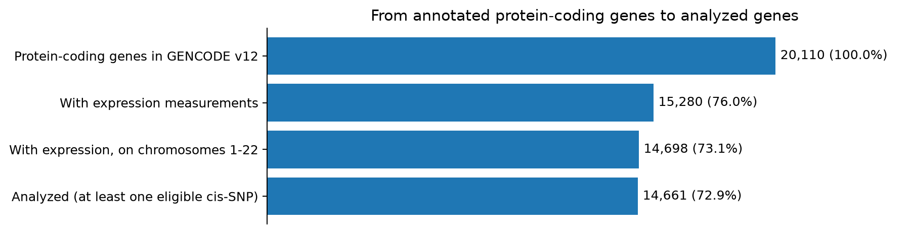
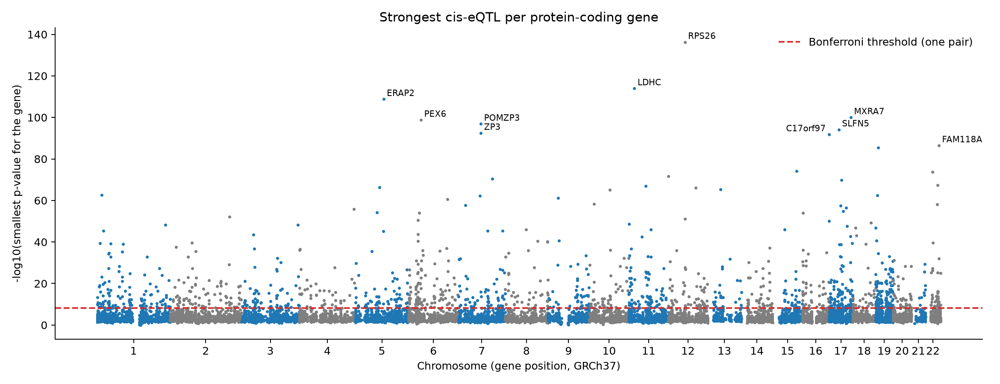
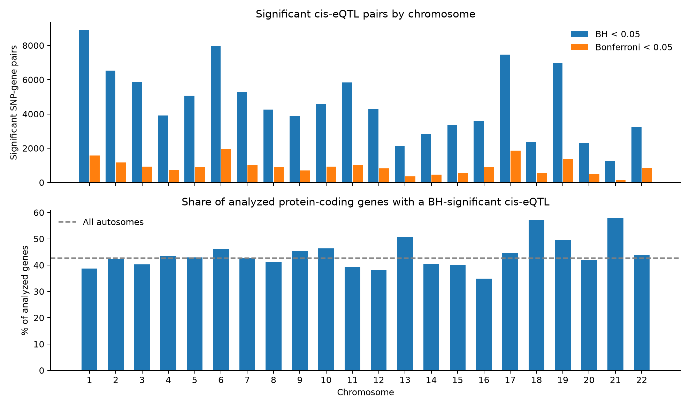
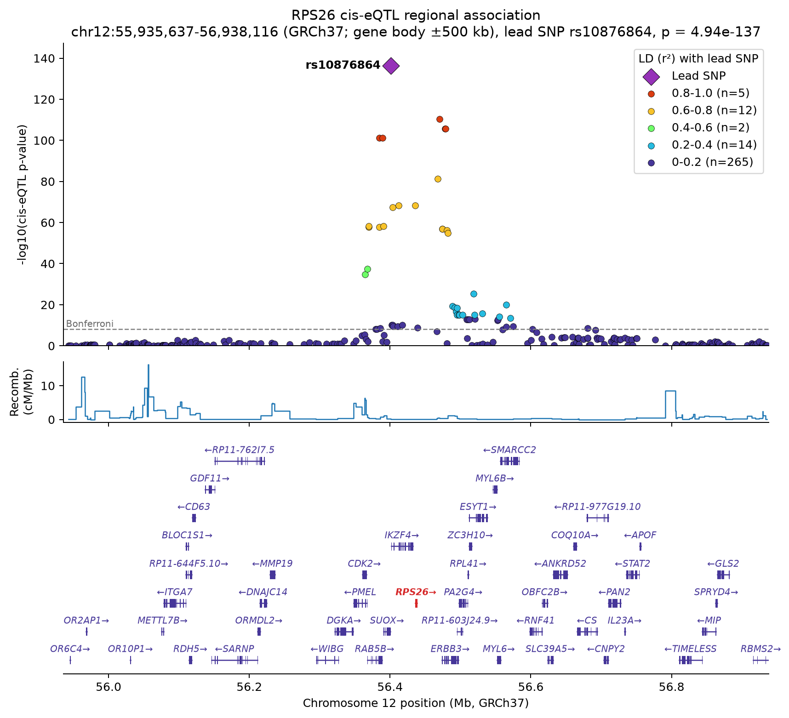

# DSC 180A — Quarter 1 Project: Part 1 Results and Interpretation

These are the results of [notebooks/quarter1_project.ipynb](notebooks/quarter1_project.ipynb). The notebook holds the code,
tables, and figures; this file holds the findings and what they mean.

## Data Used

| Data | Source | What it provides |
|---|---|---|
| Genotypes | 1000 Genomes, European reference panel (`data/LDREF/1000G.EUR.*`) | SNPs and each person's genotypes |
| Gene expression | LCL expression file (`GD462.GeneQuantRPKM...`) | Each person's expression level for each gene |
| Gene annotation | GENCODE v12, GRCh37 | Each gene's type, name, and coordinates |

The people in this analysis are the **344 people in both the European panel and the expression file**.
GENCODE contains no people or genotypes. It is only used to find out which measured genes are
protein-coding and where they sit, because neither of the other two datasets records a gene's type.

## Results

| Result | SNP–gene pairs | Protein-coding genes |
|---|---:|---:|
| Tested | 6,597,508 | 14,661 |
| Nominal p < 0.05 | 606,786 (9.2%) | 14,455 (98.6%) |
| BH across all pairs, < 0.05 | 101,916 (1.5%) | 6,258 (42.7%) |
| Bonferroni across all pairs, < 0.05 | 20,172 (0.3%) | 1,292 (8.8%) |

The Bonferroni cutoff is p < 7.58 × 10⁻⁹. The largest p-value passing BH is 7.72 × 10⁻⁴.

**How many genes were analyzed?** **14,661, not the roughly 20,000 in the project goal.** GENCODE v12
lists 20,110 protein-coding genes, but only 15,280 have measurements in the expression file:

| Excluded protein-coding genes | Genes |
|---|---:|
| No expression measurement | 4,830 |
| Not on an autosome (X, Y, or mitochondrial) | 582 |
| No eligible cis-SNPs | 37 |

So this is genome-wide across the autosomes, but it covers the 72.9% of annotated protein-coding genes
with usable data. No gene was lost to missing annotation, constant expression, or mismatched coordinates.
The genes with no cis-SNPs are mostly a real gap in the SNP panel, not an error: 20 of the 37 are on
chromosome 12, where the panel has no SNPs from about 7.0 to 10.0 Mb.

### Which Genes Have the Strongest Evidence?

**RPS26** on chromosome 12 is strongest (rs10876864, p = 4.9 × 10⁻¹³⁷), followed by **LDHC**
(1.1 × 10⁻¹¹⁴), **ERAP2** (1.6 × 10⁻¹⁰⁹), **MXRA7** (1.1 × 10⁻¹⁰⁰), and **PEX6** (1.7 × 10⁻⁹⁹). In RPS26,
median expression falls from about 257 to 173 to 85 with zero, one, and two copies of the A allele.
The lead SNP lies about 35 kb before the gene start, so the strongest association is not inside the gene.

These signals are not all separate discoveries. **POMZP3 and ZP3**, both on chromosome 7, share the
same lead SNP (rs17718122). That one variant region is associated with both genes.

Rank genes by p-value, not by beta. Betas are in each gene's own expression units, so they depend on how
highly the gene is expressed. RPS26's beta is −86, while B4GALNT3's is −0.46 with a p-value of 2.2 × 10⁻⁷².

**FAM154B needs caution.** Its lead SNP has a low minor allele count (15), and one person's expression is
8.9 standard deviations above the mean. Its p-value weakens from 8.0 × 10⁻⁷⁵ to 8.4 × 10⁻¹¹ using ranks.
It still passes the Bonferroni cutoff, but its regression p-value overstates the evidence. LDHC, MXRA7,
FAM118A, and CAV2 also weaken noticeably. All 15 of the top genes still pass the cutoff with Spearman.

### Which Chromosomes Stand Out?

**Chromosome 1** has the most BH-significant pairs (8,881), and **chromosome 6** has the most Bonferroni
pairs (1,969). These totals largely follow how many genes and SNPs each chromosome has, since chromosome 1
also has the most genes (1,566). Rates are fairer to compare: chromosomes 18 and 6 have the highest
BH rates, at 2.13% and 2.12% of tests, against 1.13% for chromosome 14.

The share of genes with a BH hit ranges from **34.8%** (chromosome 16) to **57.8%** (chromosome 21). The
highest shares, on chromosomes 21 and 18, come from chromosomes with few analyzed genes (147 and 208),
where the percentages can move more by chance. We did not test whether the differences are significant.

### The Strongest Locus: RPS26

The plot separates what LD can and cannot explain at RPS26:

- **The top of the peak is one correlated group of SNPs.** Five other SNPs have r² > 0.8 with rs10876864 and
  p-values from about 10⁻¹⁰² to 10⁻¹¹¹. These data cannot say which of them, if any, is causal.
- **p-values fall with LD.** All 33 other SNPs with r² > 0.2 pass Bonferroni. This is why 51 significant pairs
  should not be read as 51 separate effects.
- **Some hits are not explained by simple LD with the lead.** 17 Bonferroni-significant SNPs have r² ≤ 0.2 with it.
  That could point to a second signal, but we did not run a conditional analysis, so this is untested.
- **The left edge of the peak sits near a recombination spike** at about 56.36 Mb, where the LD group ends.
- **Position alone does not point to RPS26.** The strong SNPs overlap several other genes, including
  CDK2, SUOX, IKZF4, and ERBB3. The association is with RPS26 expression, but the plot does not identify the
  variant or mechanism responsible.

### What Limits These Results?

**Linkage disequilibrium.** Counts of significant pairs are not counts of independent signals. A
significant gene has a median of 9 Bonferroni-significant SNPs, because nearby SNPs are inherited
together. LDHC's top two SNPs have identical betas and p-values, so these data cannot separate them. We
did no clumping or fine-mapping here, so a lead SNP may only tag the true causal variant.

**Multiple testing.** BH and Bonferroni answer different questions. BH allows up to about 5% of its
101,916 pairs to be false, which could be around 5,100 pairs. Bonferroni is stricter than needed
because LD makes many tests redundant, so it probably misses real effects. Nearly every gene (98.6%) has
a nominal hit, so a nominal hit alone says very little. The p-value histogram shows the
expected pattern for real signals: a spike near zero over a mostly flat background. Also, genes with more
tested SNPs have more chances for a hit, and our gene counts do not adjust for that.

**Sample size.** With 344 people, power is best for common SNPs with strong effects. So 42.7% is not the
share of genes that truly have a cis-eQTL: failing to reach significance does not show a gene has none,
and some BH hits are false. Rare SNPs have the least power and are the most exposed to outliers. SNPs
with a minor allele count below 10 make up 2.4% of tests and 0.6% of Bonferroni pairs, and 59 of the 1,292
Bonferroni genes have hits only from them. Those 59 deserve the most skepticism.

**Causal interpretation.** These are associations, not demonstrated regulation. The model has no
covariates for ancestry or technical factors, as in Week 4, and all 344 people come from a European-ancestry
reference panel. The results may not transfer to other ancestries or to tissues other than LCLs. The
window also misses regulation from farther than 500 kb. Only SNPs in the reference panel were tested, so
some causal variants were never measured directly.

**Data and annotation.** The supplied expression values include negatives (range −3,465 to 75,847), so
they are not raw RPKM. We used them as supplied, and we have not confirmed exactly how they were processed.
A few GENCODE v12 gene bodies are also very long: TMPRSS3 spans 5.4 Mb and MX2 3.0 Mb, giving them 4,133 and
2,426 tested SNPs against a median of 440. We kept the annotation as is. Neither gene has a Bonferroni
hit, and together they are under 0.1% of tests, so this barely changes the family size.

### Checks and Outputs

All 23 notebook checks passed, and their results are saved in `verification_checks.tsv`. A fresh copy without the
earlier weeks' local files runs 19 of them, and they passed there too. Chromosome 1 reproduces all 668,215 of Week 4's protein-coding pairs,
with the same betas and p-values, and PARK7 reproduces Week 3. Deleting the per-chromosome results and rerunning
the notebook gave the same counts.

The chromosome 1 hit counts here are lower than in Week 4 for two expected reasons: this section keeps
only protein-coding genes, and each test is now corrected for the genome-wide family.

**Published in `results/part1/`:**

- **Tables:** `table_B_gene_summary.tsv` and `table_C_chromosome_summary.tsv`.
- **Figures:** `gene_filtering.png`, `multiple_testing_summary.png`, `significant_by_chromosome.png`,
  `snps_tested_per_gene.png`, `genome_wide_lead_cis_eqtl.png`, `top_gene_locus.png`, and `RPS26_locuszoom.png`.
- **Supporting files:** `excluded_genes.tsv`, `correction_summary.tsv`, `minor_allele_count_summary.tsv`,
  `top_gene_robustness.tsv`, and `verification_checks.tsv`.

**Created locally in `data/quarter1_results/part1/` by a full run, too large to publish:** Table A
(`table_A_genome_wide_cis_eqtl.tsv.gz`, about 280 MB), `protein_coding_genes.tsv`, and the per-chromosome results
and PLINK exports in `chromosomes/` (about 1 GB).
